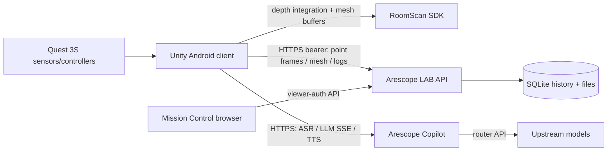

# 01 · Контекст системы

## Назначение

- Arescope — автономное Android-приложение для Meta Quest 3S, предназначенное для сканирования внутреннего помещения, визуализации глубины/геометрии и голосового взаимодействия с Copilot. [ПРОВЕРЕНО: названия сцен, компонентов и endpoints в репозиториях]
- Веб-система Arescope LAB принимает редуцированные кадры облака точек, хранит историю сессий, экспортирует PLY и принимает финальный меш. [ПРОВЕРЕНО: `/root/Developer/arescope-lab/app.py`, route declarations]
- Голосовой контур — ASR (automatic speech recognition, распознавание речи) → LLM (large language model, языковая модель) → TTS (text-to-speech, синтез речи); SDM-функциональность удалена из серверного Copilot и клиентского пути по текущему состоянию контекста. [ПРОВЕРЕНО: `arescope-beta02-core/app.py`, test suite reported 17 passed; live status endpoint ранее возвращал features `llm,asr,tts`]

## Сценарии пользователя

1. Надеть Quest 3S, запустить приложение, увидеть HUD и режим passthrough. [ПРОВЕРЕНО: проектные компоненты; требуется устройство для подтверждения]
2. Нажать X для начала сканирования; приложение запускает RoomScan SDK и показывает живые точки; поток кадров отправляется на LAB с периодом 3 секунды. [ПРОВЕРЕНО: `ScanModeBridge.cs`, `LiveFrameSender.cs`; проверка реальной очередности на текущем APK требует устройства]
3. Нажать Y для переключения отображения во время скана; после завершения скана Y циклически переключает camera-only, mixed, scan-only в спецификации 0.5.11+. [ПРОВЕРЕНО: `ScanModeBridge.cs`; кнопочные переходы на гарнитуре не подтверждены]
4. Удерживать Y 1.2 с для сброса активного скана. [ПРОВЕРЕНО: `resetHoldSeconds=1.2`; UX/контроллеры требуют проверки]
5. После завершения ожидается цветной mesh/wireframe; данные финального меша могут быть отправлены в LAB отдельным endpoint `/api/live/mesh`. [ПРОВЕРЕНО: код `MeshUploader.cs`; успешность загрузки в device logs отсутствует]
6. В voice flow пользователь зажимает grip для записи, отпускает для ASR, получает поток LLM и TTS-ответ. [ПРОВЕРЕНО: `CopilotClient.cs`, server routes; непрерывный headset QA требует проверки]
7. При уходе за tracking boundary или resume приложение должно сохранить относительное размещение scan visuals с использованием матрицы пространственного якоря. [ПРОВЕРЕНО: проектный механизм описан в `ArescopeFrame.cs`; корректность на sleep/boundary требует проверки]

## Границы системы

- Device tracking, camera passthrough, environment depth, scan buffers, and headset HUD belong to the client boundary. [ПРОВЕРЕНО: component/source layout]
- Persistent scan history, mesh/log files, live sessions, exports, and viewer APIs belong to the LAB server boundary. [ПРОВЕРЕНО: server routes and database paths]
- Speech recognition, LLM streaming, speech synthesis and settings endpoints belong to Copilot service boundary. [ПРОВЕРЕНО: `/root/Developer/arescope-beta02-core/app.py`]
- Room object classification, guaranteed semantic recognition, cross-device collaborative mapping, Play Store distribution, and Gaussian Splat training are not established MVP capabilities. [ПРОВЕРЕНО: project scope/known decisions; training/semantic outputs not in client API]
- The archive does not define an adversarially hardened public multi-tenant service; tokens are producer/viewer shared bearer credentials in the described API. [ПРОВЕРЕНО: `_authorized` route pattern]

## Inputs, outputs, external dependencies

- Inputs: headset pose/controllers, environment depth/room scan SDK output, microphone audio, runtime permissions, and optional network connection. [ПРОВЕРЕНО: component and permission config]
- Outputs: local point/mesh visualizations, HUD state, point-frame HTTPS posts, final mesh upload attempt, device log upload, ASR text, streamed LLM response, and generated audio. [ПРОВЕРЕНО: routes/components]
- External dependencies: Unity, Meta XR packages, pinned QuestRoomScan Git revision, a Meta Quest device/runtime, server-side Arescope LAB, Copilot, and OmniRoute-compatible model endpoints. [ПРОВЕРЕНО: manifests/service env names]

## Explicit unknowns

- Real headset OS build and OpenXR runtime version: даных нет. [ТРЕБУЕТ ПРОВЕРКИ]
- Current production service files may differ from local repo unless hash-verified at capture time: exact hash inventory not included here. [ТРЕБУЕТ ПРОВЕРКИ]
- Whether all user-visible 0.5.12 functionality passes on Quest 3S: данные нет. [ТРЕБУЕТ ПРОВЕРКИ]
