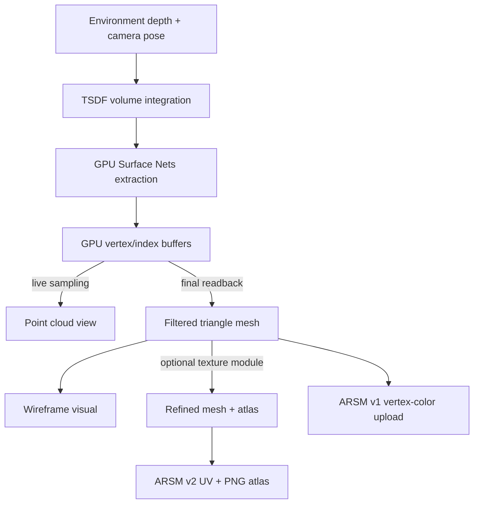

# 04 · Исследование реконструкции и выбора представления

## Pipeline, описанный в исходниках

- RoomScan source has `VolumeIntegrator`, `MeshExtractor`, `GPUSurfaceNets`, `RoomScanner` and texture refinement classes. [ПРОВЕРЕНО: pinned SDK source tree]
- `MeshExtractor` dispatches Surface Nets compute shader extraction, smoothing, temporal blend and index generation. [ПРОВЕРЕНО: `MeshExtractor.cs`, `GPUSurfaceNets.cs`, `SurfaceNetsExtract.compute`]
- `RoomScanner.FinalizeScanAsync` can invoke texture refinement/atlas work; client avoids blocking on that route for the headset final mesh and reads GPU Surface Nets data before scanner stop. [ПРОВЕРЕНО: current `ScanModeBridge.cs`; hardware correctness requires validation]

## Подходы

| Подход | Суть | Плюсы | Минусы/риски | Роль в предлагаемой системе |
|---|---|---|---|---|
| TSDF (truncated signed distance function) | Объёмная сетка хранит усечённое знаковое расстояние до поверхности; depth frames интегрируются во временной объём | [ПРЕДПОЛОЖЕНИЕ] объединяет последовательные depth observations в единую поверхность; удобен для геометрического извлечения | [ПРЕДПОЛОЖЕНИЕ] стоимость памяти растёт с voxel grid; depth noise/pose drift замыливают/смещают поверхность; точная потребность зависит от реализации | [ПРОВЕРЕНО] используется RoomScan `VolumeIntegrator`; параметры volume в текущем asset не полностью инвентаризированы |
| Surface Nets | GPU-алгоритм извлекает поверхности из TSDF в треугольную сетку с vertex/index buffers | [ПРОВЕРЕНО] это фактический RoomScan extractor; GPU compute-путь соответствует мобильному realtime pipeline | [ПРОВЕРЕНО] буфер индексов может содержать ёмкость сверх счётчика; чтение полного буфера/ошибка counters создавали пустую геометрию или артефакты; реальные драйверные лимиты не измерены | [ПРОВЕРЕНО] основной mesh pipeline |
| Texture refinement / atlas bake | Проекция keyframe imagery и UV/atlas на mesh | [ПРОВЕРЕНО] SDK предоставляет `TextureRefinement`, `RefinedMesh`, atlas result | [ПРЕДПОЛОЖЕНИЕ] может занять продолжительное время и память; фактическое время 0.5.12 отсутствует | [ПРОВЕРЕНО] optional; ARSM v2 предусматривает UV + PNG atlas; авто-финализация на Quest требует измерения |
| Vertex colors | Цвет хранится на вершинах из color volume | [ПРОВЕРЕНО] packed vertex colour offset 36 в 48-byte record; ARSM v1 передаёт RGBA по вершине | [ПРЕДПОЛОЖЕНИЕ] качество ограничено плотностью/цветной выборкой и не эквивалентно текстуре | [ПРОВЕРЕНО] fallback в `MeshUploader` |
| 3D Gaussian Splatting | Представление сцены набором anisotropic Gaussian primitives, оптимизируемых по изображениям | [ПРОВЕРЕНО: исследовательская публикация [1] описывает real-time radiance-field rendering]; обучение в текущем APK не подтверждено | [ПРЕДПОЛОЖЕНИЕ] обучение/оптимизация и renderer потребуют отдельной реализации и ресурсов; конкретный бюджет для Quest не измерен | [ПРОВЕРЕНО] отложено; не включено в current MVP |

## Предлагаемое решение

- Использовать TSDF → GPU Surface Nets как основное геометрическое представление, поскольку pinned SDK уже содержит этот pipeline. [ПРОВЕРЕНО: dependency source]
- Live feedback: sample GPU vertex records в ограниченное окно, уменьшить число повторов через voxel occupancy cache, визуализировать цветные quads. [ПРОВЕРЕНО: код 0.5.11+; честный накопительный результат ещё требует измерения]
- Final view: filter invalid triangles; render a bounded wireframe or mesh surface. [ПРОВЕРЕНО: implementation design]; mesh quality in Quest 0.5.12 [ТРЕБУЕТ ПРОВЕРКИ]
- Upload path prefers refined texture mesh, falls back to packed vertex colors. [ПРОВЕРЕНО: `MeshUploader.cs`]
- Gaussian Splatting не включать до стабильного room mesh, measured frame-time budget and explicit need for photorealistic view. [ПРЕДПОЛОЖЕНИЕ: architecture recommendation]

## Точные параметры и вычисления

- `VertexStride=48` bytes; position offset `0`, normal offset `24`, packed colour offset `36`; counters length `4 * 4 = 16` bytes. [ПРОВЕРЕНО: pinned SDK source]
- GPU vertex buffer capacity formula: `max(1024, floor(totalVoxels * vertexBudgetPercent))`; `vertexBudgetPercent` is method default 0.05, component serialized default 0.08, scene override unknown. [ПРОВЕРЕНО/ТРЕБУЕТ ПРОВЕРКИ]
- GPU index buffer capacity formula: `maxVertices * 18` elements × 4 bytes each. [ПРОВЕРЕНО: pinned source]
- Live point readback cap: `12 * 1024 * 1024 = 12,582,912` bytes per request. [ПРОВЕРЕНО: current `ArescopeLiveCloud.cs`]
- 0.5.12 capture cache: voxel size `0.035 m`, cache capacity `60,000`, sample request buffer `6,000` positions per cycle, nominal cycle interval `0.2 s`. [ПРОВЕРЕНО: source defaults; serialized scene override unknown]
- Final triangle filter: sample up to 60,000 edge lengths; median edge ×4, clamped to `[0.06, 0.30] m`; edges above threshold drop the triangle. [ПРОВЕРЕНО: `ArescopeMeshExport.cs`]
- False positives: a long but valid surface triangle can be rejected; false negatives: median can inflate if many long garbage edges contaminate sample. [ПРЕДПОЛОЖЕНИЕ: algorithmic consequence; test against headset logs/ground truth]

## Evidence and limitations

- User-provided screenshots from the previous release showed orange lines spanning empty space, large holes and highly uneven point density. [ПРОВЕРЕНО: image artifacts listed in session cache, qualitative visual review]
- A 0.5.8 headset log recorded `wireframe ready` with 62,374 vertices/118,298 triangles and later wire diagnostic stats with 59,149 triangles retained and 30,900 unique edges. [ПРОВЕРЕНО: `20261113-081211-pause.log`; latest boot marker app=0.5.8]
- These observations establish a historical defect, not proof that the 0.5.12 filter removes it. [ПРОВЕРЕНО: version difference; [ТРЕБУЕТ ПРОВЕРКИ] new run]

## Sources

[1] Kerbl et al., “3D Gaussian Splatting for Real-Time Radiance Field Rendering”, https://arxiv.org/abs/2308.04079. [ПРОВЕРЕНО: publication reference; comparative performance in this project remains unmeasured]
[2] Meta OpenXR Depth API Overview, https://developers.meta.com/vr/documentation/native/android/mobile-depth/. [ПРОВЕРЕНО: official API reference]
[3] SDK implementation at revision `4791b24b81015641d4cfb010a93c6283d4eb3dee`; archiveable clone path `/root/QuestRoomScan-audit/Runtime/Core/`. [ПРОВЕРЕНО: local clone/source]
