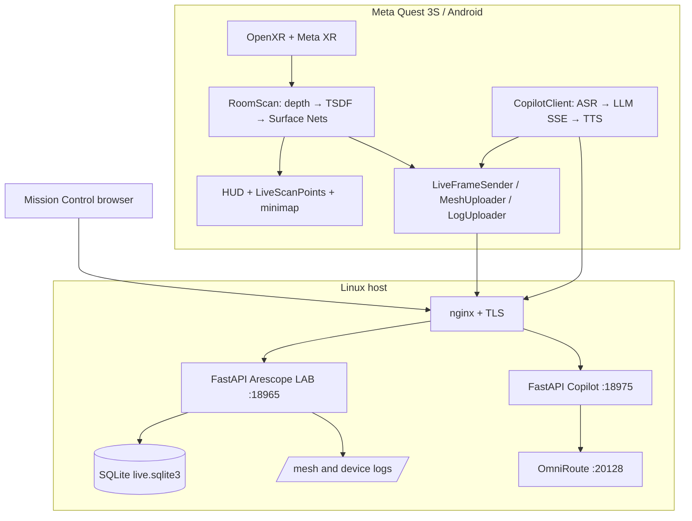
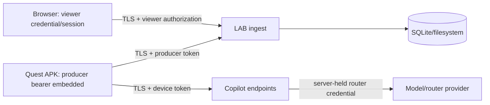

# 06 · Архитектура и развертывание

## Компоненты



- LAB local bind: `127.0.0.1:18965`, systemd unit `arescope-lab.service`, working directory `/root/Developer/arescope-lab`, env file `/etc/arescope-lab.env`. [ПРОВЕРЕНО: systemd unit]
- Copilot local bind is referenced historically at `127.0.0.1:18975`; current systemd unit/port deployment must be re-read before a clean rebuild. [ПРОВЕРЕНО: prior service checks in session history; [ТРЕБУЕТ ПРОВЕРКИ] current unit inventory]
- OmniRoute base URL default in Copilot is `http://127.0.0.1:20128/v1`. [ПРОВЕРЕНО: server `app.py` default]
- Public domains used by clients: `arescope.mrfenek.eu.cc`, and Copilot routes through same origin. [ПРОВЕРЕНО: client endpoint constants; nginx mapping exact locations not captured here]

## Компоненты и их ответственность

| Компонент | Ответственность | Постоянное состояние | Статус |
|---|---|---|---|
| XR session/bootstrap | запуск runtime, камера шлема, passthrough, tracking | отдельная app DB не выявлена | [ПРОВЕРЕНО: layout исходников; runtime не тестировался] |
| RoomScanner / VolumeIntegrator | интеграция depth в TSDF и жизненный цикл скана | runtime state принадлежит SDK; возможное SDK persistence | [ПРОВЕРЕНО: pinned SDK source] |
| MeshExtractor / GPUSurfaceNets | GPU Surface Nets buffers, counters и indirect draw args | GPU buffers до stop/release | [ПРОВЕРЕНО: pinned SDK source] |
| ArescopeMeshExport | ограниченный GPU readback, фильтр индексов/рёбер, CPU mesh arrays | managed arrays до upload/render | [ПРОВЕРЕНО: проектный source] |
| LiveScanPoints / LiveScanMinimap | live point view, voxel accumulation и HUD projection | in-memory cache | [ПРОВЕРЕНО: проектный source] |
| LiveFrameSender | передача кадров точек и статуса | runtime statics, серверная история | [ПРОВЕРЕНО: client/server source] |
| MeshUploader | загрузка финального меша ARSM | mesh file на сервере по session | [ПРОВЕРЕНО: client/server source] |
| LogUploader | загрузка текущих/предыдущих crash logs | local rolling log + server files | [ПРОВЕРЕНО: client/server source] |
| LAB API | ingest, live WebSocket/view, sessions, exports, logs | SQLite + filesystem | [ПРОВЕРЕНО: server source; внешний WebSocket path проверен в API, nginx forwarding ещё проверить] |
| Copilot | ASR/LLM/TTS relay и settings | SQLite settings; secrets в env | [ПРОВЕРЕНО: source/env names; production hash неизвестен] |

[ПРОВЕРЕНО: names/source responsibilities; some SDK persistence details require reading pinned source and profile files]

## Trust boundaries



- Device producer token in `Resources/arescope-live-token.txt` is extractable from APK. [ПРОВЕРЕНО: `LiveFrameSender.cs` comment]
- Viewer, producer, Copilot device and panel secrets must be distinct. [ПРОВЕРЕНО: Copilot `authorize` function enforces panel/device distinctness; LAB roles use distinct env names]
- No secret values are copied into this archive. [ПРОВЕРЕНО: archive content policy]
- TLS termination is expected at nginx/public edge; certificate chain and Cloudflare/WAF details are not included in captured source. [ТРЕБУЕТ ПРОВЕРКИ]

## Failure propagation

```text
XR/session failure ──> no scan buffer ──> no points/mesh ──> HUD/error log
GPU readback failure ──> diagnostic reason ──> no final render/upload
Wi-Fi/TLS failure ──> UPLINK status; scan can continue locally
LAB DB failure ──> LIVE_FRAMES still updated; history storage error counter increments
Copilot upstream failure ──> SSE error or ASR/TTS HTTP failure; no offline fallback specified
```

- LAB implementation catches history-write errors so that a storage failure does not stop live feed publication. [ПРОВЕРЕНО: `post_frame`]
- Exact websocket reconnect and message replay contract: данных нет. [ТРЕБУЕТ ПРОВЕРКИ]
