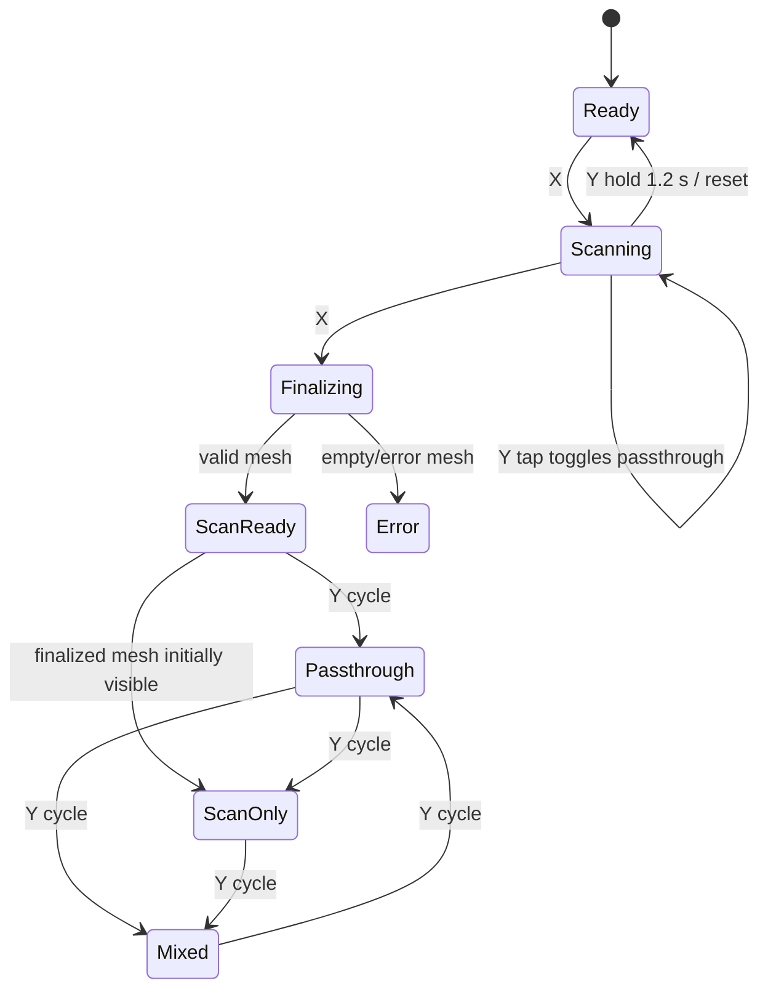

# 09 · Дизайн клиентского приложения

## Компонентная структура

```text
Assets/Arescope/
  ScanModeBridge        controller state, scan start/stop/reset, view modes
  ScanWireframe         final mesh lines + point billboards
  LiveScanPoints        GPU sample → voxel cache → frustum-filtered render mesh
  LiveScanMinimap       live/final mesh point projection to HUD map
  ArescopeFrame         scan capture matrix and relocation application
  LiveFrameSender       point frame JSON upload
  MeshUploader          ARSM mesh upload
  LogUploader           log snapshots/upload/crash marker
  HudContrast           per-panel backdrop adaptation
Assets/ArescopeClient/
  CopilotClient         PTT microphone, ASR, LLM SSE, TTS playback
```

[ПРОВЕРЕНО: repository source paths]

## Screens/HUD

- Immersive scan scene with peripheral HUD, status panels, minimap, voice/Copilot panels. [ПРОВЕРЕНО: `Assets/ArescopeHud` sources/scenes]; actual rendered layouts depend on scene wiring.
- View states: `Passthrough`, `Mixed`, `Scan`. [ПРОВЕРЕНО: `ModePolicy.cs` and `ScanModeBridge.cs`]
- Scan state: ready → scanning → processing/readback → completed or failure. [ПРОВЕРЕНО: ScanModeBridge/HUD event calls]
- Voice state enum: Idle, Recording, Uploading, Streaming, Speaking, Cancelled, Error. [ПРОВЕРЕНО: CopilotClient]

## Controller map

| Input | Intended action | Status |
|---|---|---|
| Left X tap | Start scan / finalize current scan | [ПРОВЕРЕНО: source mapping; [ТРЕБУЕТ ПРОВЕРКИ] controller mapping on headset]
| Left Y tap during scan | Toggle passthrough while scan continues | [ПРОВЕРЕНО: source]
| Left Y hold ≥1.2 s | Reset/unload active scan | [ПРОВЕРЕНО: source]
| Left Y tap when finalized | Cycle Passthrough → Mixed → Scan | [ПРОВЕРЕНО: 0.5.11+ source]
| Right grip hold/release | Push-to-talk start/stop | [ПРОВЕРЕНО: Copilot integration description/source path; actual controller setup requires verification]
| X+Y hold ≥2 s | Upload device log | [ПРОВЕРЕНО: LogUploader design; actual trigger wiring in scene should be checked]

## State transition diagram



- Post-finalization current source sets `passthrough.enabled=false` and immediately displays the wireframe; this is scan-only. Internal cycle variable `viewMode` starts at 0 (`Passthrough`) and is not synchronized to that initial state, so first Y enters state 1 (`Mixed`) and later reset/cycle state can be offset. [ПРОВЕРЕНО: `ScanModeBridge.cs`; [ТРЕБУЕТ ПРОВЕРКИ] actual visible mode and user-facing labels]
- Target state machine in the diagram describes intended transitions; exact post-reset/current view synchronization is inconsistent in source. [ПРОВЕРЕНО: source transition discrepancy]

## Network degradation

- Point frame HTTP errors update static status; local scan should remain independent of LAB ingestion. [ПРОВЕРЕНО: code path uses async sender; [ТРЕБУЕТ ПРОВЕРКИ] runtime independence under slow requests]
- Mesh upload failure sets `LastResult` to HTTP/error description; no guaranteed retry queue is present in `MeshUploader`. [ПРОВЕРЕНО: source]
- Log uploader starts on application pause and X+Y; startup with a remaining `.running` marker triggers crash-recovery upload. `OnApplicationQuit` only removes the marker; it does not initiate a new HTTP upload. [ПРОВЕРЕНО: `LogUploader.cs`]
- Voice requests fail into client Error state; no local/offline models included. [ПРОВЕРЕНО]

## Relocalization contract

- Capture `A_capture` matrix when scan starts; when current anchor matrix `A_now` changes, calculate `R = A_now * inverse(A_capture)`. [ПРОВЕРЕНО]
- Position-only, rotation-only and yaw behavior after actual sleep/wake/boundary crossing: not confirmed. [ТРЕБУЕТ ПРОВЕРКИ]
- Acceptance test should record at least 3 boundary exits/re-entries and 3 sleep/resume cycles; compare a fixed door/cabinet target against passthrough with target RMS offset ≤5 cm and yaw error ≤3° (proposed thresholds). [ПРЕДПОЛОЖЕНИЕ: proposed acceptance values]
