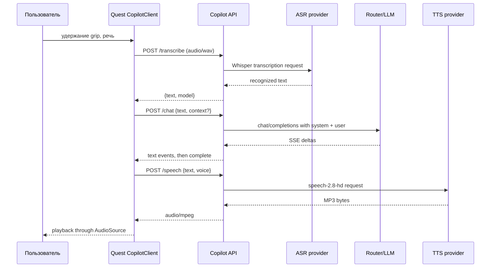

# 19 · Voice Copilot: подробная функциональная спецификация

## Контур

[ПРОВЕРЕНО: Copilot client/server source; exact timing on Quest not measured]

## Client state machine

- `Idle → Recording` on PTT begin; microphone records 16,000 Hz mono/stereo according to captured clip; project default sample rate 16 kHz. [ПРОВЕРЕНО: `CopilotClient.cs`]
- `Recording → Uploading` on release; WAV is built as PCM16. [ПРОВЕРЕНО]
- `Uploading → Streaming` after ASR returns recognized text; client emits transcript event. [ПРОВЕРЕНО]
- `Streaming → Speaking` after an SSE `complete` event; speech generation begins only after complete, not on partial deltas. [ПРОВЕРЕНО]
- `Speaking → Idle` after audio playback; any stage can fail to `Error`; cancel yields `Cancelled`. [ПРОВЕРЕНО]

## ASR contract

- `POST /api/copilot/transcribe`, `Content-Type` one of `audio/wav`, `audio/x-wav`, `audio/mpeg`, `audio/webm`, `audio/mp4`. [ПРОВЕРЕНО]
- Maximum audio body: `8 * 1024 * 1024 = 8,388,608` bytes. [ПРОВЕРЕНО]
- Upstream model string: `groq/whisper-large-v3-turbo`; server HTTP timeout 60 s. [ПРОВЕРЕНО: `app.py`]
- Success response `{text:string, model:string}`; blank or >12,000 character transcription rejected and mapped to 502. [ПРОВЕРЕНО]
- Error responses: 401 unauthorized; 415 media type; 413 body limit; 400 empty payload; 502 transcription unavailable. [ПРОВЕРЕНО]

## LLM contract and prompt policy

- `POST /api/copilot/chat` JSON `{text, context?}`; each field must be non-empty text where required and ≤12,000 chars; request body ≤32 KiB. [ПРОВЕРЕНО]
- Server sends `messages=[system,user]`, `stream=true` to router `/chat/completions`. [ПРОВЕРЕНО]
- Model order in source: `cx/gpt-6-luna`, `th/glm-5.3-flash`, `th/gpt-6-luna`, `agy/gemini-3.8-flash-tiered`. [ПРОВЕРЕНО: `copilot_core.py`]
- Fallback is allowed before any text is emitted; once a model emits a delta, no model switch occurs. [ПРОВЕРЕНО]
- System-prompt policy: Russian mission-scoped astronaut assistant; concise 1–3 sentence replies; safety priority; do not invent sensor/map/location/actions; ask one concrete question when information is missing; redirect unrelated prompts toward expedition context. [ПРОВЕРЕНО: prompt semantics; full prompt text intentionally not copied]
- LLM completion output max 12,000 chars; upstream response byte cap 4 MiB; stream frame buffer max 1 MiB. [ПРОВЕРЕНО]
- SSE event schema: `{type:"text",text,model}`, `{type:"complete",text,model}`, `{type:"error",message}`. [ПРОВЕРЕНО]
- No SDM decision endpoint is part of target; project history says live `/api/copilot/decision` returned 404 after removal. [ПРОВЕРЕНО: earlier probe; current deploy hash still needs verification]

## TTS contract

- `POST /api/copilot/speech`, JSON fields `text`, `voice`; voice key `male` or `female`. [ПРОВЕРЕНО]
- Voice IDs: `male → Deep_Voice_Man`; `female → Calm_Woman`. [ПРОВЕРЕНО: `copilot_core.py`]
- Upstream model: `minimax/speech-2.8-hd`; response format MP3; voice setting speed 0.95, volume 1, pitch 0; normalization `basic`; server timeout 90 s; body max 32 KiB and output cap 8 MiB. [ПРОВЕРЕНО]
- Client decodes downloaded file to Unity audio and uses configured volume `0..1`. [ПРОВЕРЕНО]

## Settings contract

- Defaults: voice `male`, volume `1.0`, `hud_enabled=true`, `hud_follow_mode="smooth"`. [ПРОВЕРЕНО]
- Allowed `hud_follow_mode`: `hard` or `smooth`; volume range 0..1. [ПРОВЕРЕНО]
- Settings stored in SQLite at env `ARESCOPE_SETTINGS_DB`; DB connection timeout 5 s; mode 0600. [ПРОВЕРЕНО]
- Acknowledgement reports `device_applied=true` for 30 seconds after latest matching version. [ПРОВЕРЕНО]

## Authentication and failure mapping

- Panel and device tokens must be distinct, each at least 24 characters in current authorize helper; token values excluded. [ПРОВЕРЕНО]
- Origin, when provided, must be in `ARESCOPE_ALLOWED_ORIGINS`; scheme HTTP/HTTPS only. [ПРОВЕРЕНО]
- Upstream router key is server-side `OMNIROUTE_API_KEY`; no key is embedded in APK. [ПРОВЕРЕНО: service source/config naming]
- Offline operation: ASR, LLM and TTS require network; no local fallback exists. [ПРОВЕРЕНО]
- Client audio length limit: max recording 60 s default, user-configurable up to 120 s; client request timeout 45 s default, clamped 1..180 s. [ПРОВЕРЕНО]
